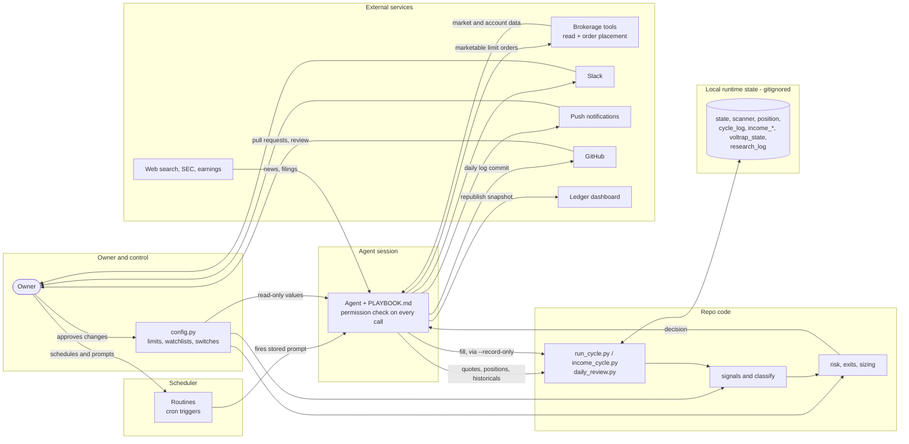
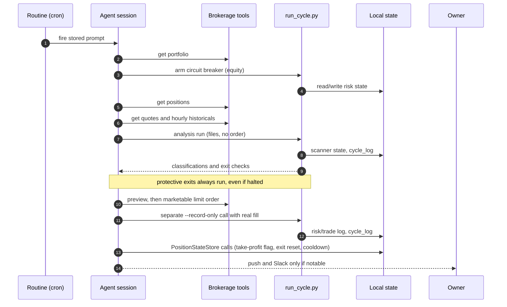

# System architecture and data flow (reference)

**Purpose:** one place that says how the system fits together and what rules a new
build must follow, so future strategies, routines and tools slot in the same way.
Written 2026-10-24 from the live repo and routine configuration. It describes
structure, not live values: `trading_agent/config.py` holds the numbers,
`trading_agent/PLAYBOOK.md` the procedures, `trading_agent/STATUS.md` what is on or
off today, `trading_agent/CHANGELOG.md` the history. If this note disagrees with
those, they win; fix this note.

Rules of engagement from `COLLABORATION.md` still apply to any build: real-money
system, no brokerage access needed to develop, never edit or commit runtime state,
protected config values change only with explicit owner approval.

## 1. Layers

| Layer | What it is | Examples |
|---|---|---|
| Owner and control | The only authority over limits, watchlists, auto-execute switches, schedules. | Approvals in chat; `config.py` edits; pull request merges. |
| Scheduler | Persistent routines (cron triggers). Each fires a stored prompt into one persistent agent session. | Hourly cycle, income cycle, daily review. |
| Agent session | An AI agent (Claude) that reads the prompt, then the runbook, then executes. A permission check sits in front of every tool and script call. | `PLAYBOOK.md` steps. |
| Repo code | Pure calculation modules and small CLI helpers. Calculation is kept separate from persistence and external tools. | `scanner_signals.py`, `risk_manager.py`, `run_cycle.py`. |
| Local runtime state | JSON files next to the code. Gitignored, never edited by hand, never committed. | `state.json`, `cycle_log.json`. |
| External services | Brokerage tools (read and order placement), Slack, push notifications, GitHub, a published dashboard, web search. | See section 3. |
| Outputs | Orders, notifications, Slack posts, committed daily logs, the dashboard. | |

## 2. System context diagram

## 3. Component inventory

### Strategies (each independent: own limits, own state, own routine)

| Strategy | Signal | Exits | Limits and state | Cadence |
|---|---|---|---|---|
| Main bot (stocks; crypto is cut) | SMA(10,30) hourly cross via `equity_signals` + `scanner_signals.classify`; `excellent_watch` is alert-only | `exit_criteria` stop-loss and partial take-profit; `profit_gate` holds a sell-cross exit below breakeven | `RISK_LIMITS`; `state.json`, `position_state.json`, `scanner_state.json`, `cycle_log.json` | Hourly in market hours |
| Income sleeve | `income_signals.classify_entry` (dip percentile plus support zone); volume-surge gate on two names | `income_exit` stop-loss and trim | `INCOME_RISK_LIMITS`; `income_risk_state.json`, `income_position_state.json`, `income_cycle_log.json` | Daily, once |
| VOLTRAP (options wheel) | Candidate screen plus strike pick by delta (`voltrap_candidates`) | State-machine resolution at expiration (`voltrap_state`); rolling is out of scope | `VOLTRAP_RISK_LIMITS`; `voltrap_state.json` | Weekly entry, daily monitor |

### Support and reporting (no order placement)

| Component | Role | Reads | Writes |
|---|---|---|---|
| Research agent | News, SEC filings, upcoming earnings for the stock and VOLTRAP watchlists. Advisory only: never trades or gates a trade. | Web search, filing and earnings tools | `research_log.json` (durable), a local digest note |
| Daily review | End-of-day report. | `cycle_log.json`, trade log, brokerage orders and realized P/L | `daily_logs/DATE.md` (committed), push, Slack |
| Ledger refresh | Read-only dashboard snapshot. | Brokerage state, local logs, daily logs | The published dashboard artifact only |
| Watchlist review | Recommendation only; never edits config. | Real trade history, historicals, scans | A dated review file |
| Reconcile ledger | Canonical trade ledger from broker records, not from local approximations. | Broker orders and realized P/L | A report |

### External services

- **Brokerage tools:** read (portfolio, positions, quotes, historicals, orders, realized P/L, option chains) and write (place and cancel equity and option orders). Only three flows write; see section 5.
- **Slack:** notable events and the daily report; a second agent (the code reviewer) also reads it.
- **Push notifications:** the owner's direct alert channel.
- **GitHub:** committed daily logs and docs; pull requests and review.
- **Dashboard artifact:** a published page rendered from a JSON snapshot.
- **Web search, SEC and earnings tools:** used only by the research agent.

## 4. Hourly stock cycle (one run)

Notes that matter when building on this:
- `run_cycle.py --record-only` writes only the risk/trade log (`state.json`) and the
  cycle log. It does **not** touch `position_state.json`: for the main bot the agent
  makes separate `PositionStateStore` calls (mark a take-profit as taken, record and
  reset a full exit, gate-block bookkeeping) per PLAYBOOK "Per-position exit rules".
  A new build that omits them can repeat a partial take-profit or miss cooldown
  bookkeeping. The income CLI differs: `income_cycle.py --record-only` also updates
  its own position state (for example `record_exit`), so do not copy one pattern to
  the other without checking the script.
- The analysis run and the fill recording are two separate invocations. Re-running
  analysis with fill flags classifies identical inputs twice and advances
  `scanner_state.json` a second time (a real bug on 2026-10-05).
- The permission check can deny a script call. The agent reports and stops; it does
  not try variants.

## 5. State ownership and write boundaries

| Writer | May write | Must never write |
|---|---|---|
| Main-bot routine | `state.json`, `position_state.json`, `scanner_state.json`, `cycle_log.json` | `income_*`, `voltrap_state.json`, `config.py` |
| Income routine | `income_risk_state.json`, `income_position_state.json`, `income_cycle_log.json` | The main bot's state files, `config.py` |
| VOLTRAP routines | `voltrap_state.json` (monitor: bookkeeping only) | Orders from the monitor; `config.py` |
| Research agent | `research_log.json`, local digest | Any trading state; any order |
| Daily review | `daily_logs/DATE.md` | Anything else; any order |
| Ledger and watchlist review | Their own output only | Runtime state; `config.py`; any order |
| Owner | `config.py`, routine schedules and prompts, merges | |

Order placement exists in exactly three flows: the main-bot hourly routine, the
income routine, and the VOLTRAP weekly entry. Every other flow is read-only. Keep it
that way: a new read-only component must not gain a write path.

## 6. Design rules for new builds

1. **One strategy, one budget, one state.** A new strategy gets its own limits dict in
   `config.py`, its own state file(s) via a thin `*_state.py` (as `income_state.py`
   wires `RiskManager`/`PositionStateStore` to separate paths), its own routine and
   its own runbook section. It shares only the real account's cash, so state how it
   coordinates (see the VOLTRAP budget reserve for the income sleeve).
2. **Pure calculation, thin I/O.** Signals, sizing and exits are pure functions with
   tests. Persistence and tool calls stay in the CLI helper and the agent.
3. **Orders:** marketable limit orders only, whole shares where the venue requires,
   no market-order fallback. A signal that cannot execute is reported, not forced.
4. **Protective exits are never gated** by the circuit breaker or the daily trade cap;
   new entries are.
5. **Record fills separately.** Analysis first, order, then a `--record-only` call with
   the real fill price from the broker (never the limit price).
6. **Protected config.** Routines never edit `config.py`. A parameter change needs
   multi-window historical backtests (worst case first) and explicit owner approval,
   with README, CHANGELOG and PLAYBOOK updated in the repo's dated style. Read the
   rejected studies first (`trading_agent/EVIDENCE_INDEX.md`).
7. **Advisory components stay advisory.** Research and review output informs; it does
   not resize or block a trade.
8. **Reporting is read-only** and quiet by default: notify only when something notable
   happened, except the daily report, which always goes out.
9. **Prompts point at the runbook.** A routine's stored prompt should name the
   PLAYBOOK section as the source of truth and keep only overrides and hard rules.
   Long copies drift: the income prompt once passed a removed flag, and the
   VOLTRAP monitor once said "recommend-only" while config said auto-execute.
10. **Schedules in market terms.** Use `CRON_TZ=America/New_York` for market-hours jobs
    so clock changes need no edit; use UTC only for fixed-UTC requirements.
11. **Isolation by default.** Develop in a separate worktree with no runtime state;
    never smoke-test the live helpers against real state files.

## 7. Checklist: adding a new strategy or routine

- [ ] Objective, owner approval, implementer and reviewer agreed; handoff note from
      `docs/handoffs/TEMPLATE.md`.
- [ ] Limits dict and watchlist added to `config.py` (owner-approved), with a
      one-line comment per value and the history in `CHANGELOG.md`.
- [ ] Signal and exit functions written as pure code with tests.
- [ ] Own state paths; confirmed it cannot write another strategy's files.
- [ ] CLI helper with the `--record-only` / `--record-trade-*` pattern if it places
      orders.
- [ ] PLAYBOOK section with the per-cycle steps, hard rules and failure handling.
- [ ] Backtest with real history across multiple windows if it sets a parameter;
      negative results reported.
- [ ] Budget coordination with the other strategies stated.
- [ ] Routine prompt that points at the PLAYBOOK section; schedule in market time.
- [ ] `STATUS.md` row added; this note's diagrams and tables updated.
- [ ] Full test suite run on the exact reviewed head; review before merge; no deploy
      as a side effect of merging.

## 8. Failure modes already seen

| What happened | Lesson |
|---|---|
| Routine prompt passed a flag the script no longer accepted. | Keep prompts thin; verify the script's `--help`. |
| Stale checkout made code look missing. | Fetch and compare before reporting a gap. |
| Fill recorded on the analysis command double-advanced scanner state. | Separate `--record-only` call. |
| Income signals fired but could not execute (cap left under one share). | Check whole-share sizing against per-name prices when setting limits. |
| Permission check denied a script call that earlier runs were allowed. | Report and stop; ask for explicit approval; do not retry variants. |
| Fixed-UTC schedule drifted an hour at the clock change. | Use `CRON_TZ`. |
| Local ledger totals disagreed with the broker's. | Reconcile from broker records. |

## 9. Visual version

`docs/architecture/dataflow-visual-prompt.md` holds a prompt that turns this note
into a rendered diagram set with an image generator or assistant.
